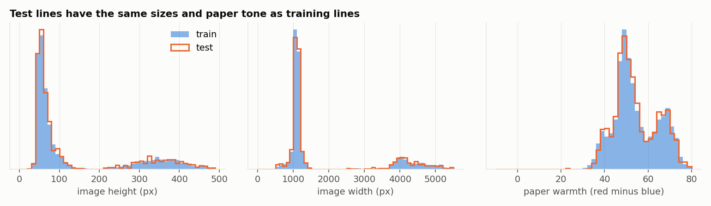
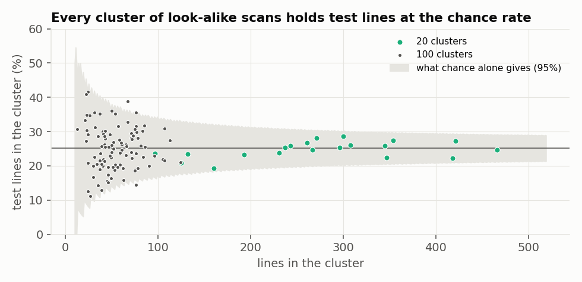
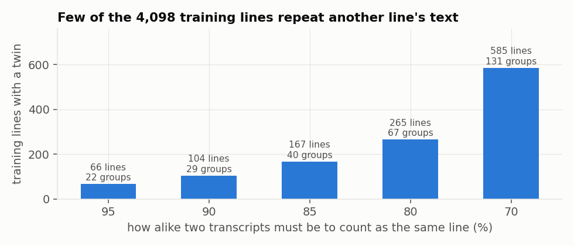
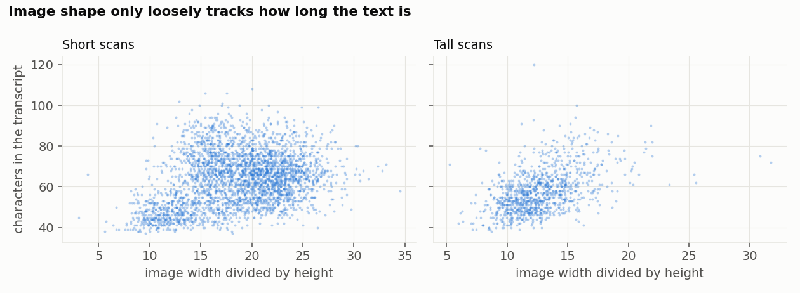

# EDA Report

Run 2026-10-13 with `notebooks/eda.py` (questions 1 to 3 of [[EDA Plan]]). The competition is closed; this is
practice. Questions 4 to 6 need a trained reader and a GPU and have not been run.

## 1. Test lines are a random quarter of the same scans as training lines

- 5,472 images. A classifier cannot tell test from train: AUC 0.496 on size, tone and ink; 0.518 on an image embedding.
- 0 of 20 clusters of look-alike scans have more or fewer test lines than chance gives; none is test-only.
- Tall scans: 25.5% of train, 25.1% of test.

**So we will** use random folds at line level, not held-out pages or writers. ([[FND-001 Test lines are a random quarter of the same scans as training lines]])

## 2. The two height batches are two kinds of document at two scales

- Short scans: 56 px high, 16.7 px per character. Tall scans: 352 px high, 76.5 px per character.
- By eye, short scans are a clean later hand; tall scans are older hands on stained paper.

**So we will** balance folds on the batch, report scores per batch and test one common letter size. ([[FND-004 The two height batches are two kinds of document at two scales]])

## 3. Repeated text is rare and no image is a copy of another

- 167 of 4,098 training lines (4.1%) are 85% alike or more to another line, in 40 groups.
- No two of the 5,472 images are near-copies (closest pair 71 of 256 hash bits).
- 10.1% of held-out word tokens are new to the other four folds.

**So we will** keep text twins in one fold and group nothing else. ([[FND-002 Only 4 percent of training lines repeat another line and no two images are copies]])

## 4. Nothing outside the picture gives the text away

- Zip order, file names, timestamps, IDs and the sample submission carry no information about split or text.
- Image shape tracks text length only loosely (rho 0.28 short, 0.59 tall).

**So we will** exclude nothing, and not use size or order as features. ([[FND-003 No leak in file order, IDs, timestamps or the sample submission]])

## 5. Labels by hand

- about 40 training lines read against their labels, as reduced thumbnails. Transcripts follow the writing closely, superscripts as `^`.
- Multi-line crops are labelled both ways (centre line only, or every line). 98 labels have edge spaces.

**So we will** settle whitespace handling in the scorer and leave label cleaning until a reader can rank lines by error. ([[F-005 Transcripts run 37 to 120 characters and some carry stray spaces]])

## What this adds up to

- Validation: 5 random folds, text twins together, balanced on height batch; score all 4,098 out-of-fold lines
  ([[D-001 Five random folds, twins kept together, balanced on scan height]]).
- Signal: the pixels of the line. Size, order and IDs carry nothing useful.
- Noise: not measured yet (needs a reader). An entrant reports 0.0048 on 820 lines.
- Leaks and label problems: no leak found. Label noise (about 1 line in 70, per an entrant) is unchecked.

## Still unanswered

- Q4: how many labels are wrong, and which rows to drop.
- Q5: how noisy a held-out score is, and the smallest gain worth adopting.
- Q6: which kinds of error a simple reader makes.
- Whether the organisers kept repeated lines out of the test set.
- Which labelling convention multi-line test crops follow (thread 34089, no ruling).
